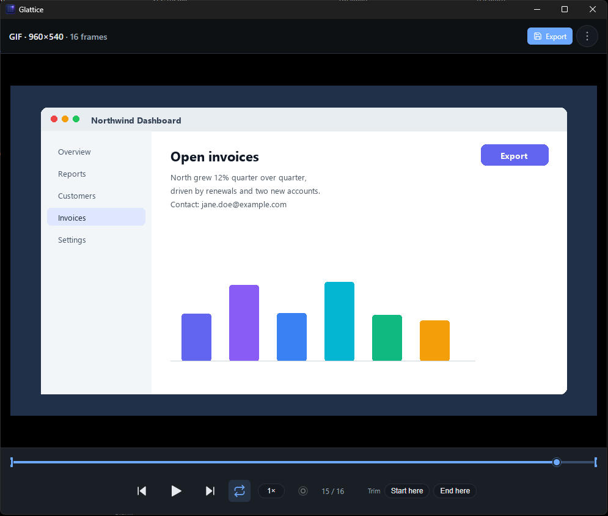
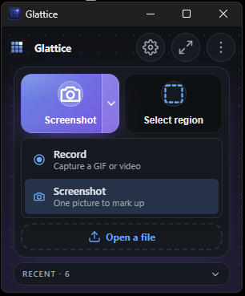
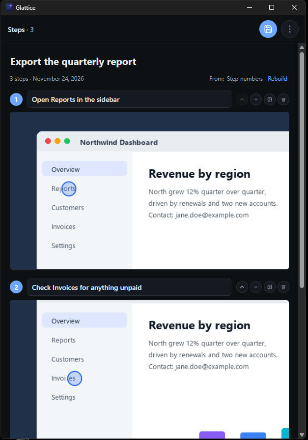

# Glattice

<p align="center">
  
</p>

A lightweight screen recorder and screenshot tool for bug reports, how-tos and tutorials. Record your screen or grab a single picture, mark it up, and share it as an animated GIF, a video, an annotated image, or a numbered step-by-step guide.

Built with [Tauri v2](https://tauri.app), React 19, and Rust. Runs on Windows 10 and 11.

<p align="center">
  
</p>

| Player | Frames |
| --- | --- |
|  |  |

| Record or screenshot | Step-by-step guide |
| --- | --- |
|  |  |

Everything stays on your computer: Glattice makes no network connections and collects nothing. See [PRIVACY.md](PRIVACY.md).

---

## What you can do with it

- **Record a GIF or video** of the whole screen or a region, with click rings, key presses and the cursor shown.
- **Take a screenshot**, or a scrolling screenshot of a whole page, and mark it up straight away with arrows, text, blur and numbered steps.
- **Edit any frame**: annotate, redact, reorder, trim, or hold a frame on screen longer.
- **Turn a recording into a guide**: one numbered close-up per click, with captions, exported as an image, a web page or Markdown.
- **Export** as GIF, MP4, WebM, a sprite sheet, or a single frame, or copy a frame to the clipboard.

---

## Install

Download the latest installer from the [Releases](https://github.com/ingnio/glattice/releases) page and run it. It installs for your user account only, so it doesn't need administrator rights.

The installers are not code-signed yet, so Windows SmartScreen may warn the first time. Choose **More info**, then **Run anyway**.

To build it yourself instead, see [Building](#building).

---

## Features

### Recording
- **Full-screen or region capture** — drag to select any area, or snap to a detected window
- **Configurable FPS** — presets (2 / 5 / 10 / 15 / 30) plus a custom input
- **Click indicators** — animated rings at each click (left = amber, right = red, middle = purple)
- **Key press display** — recent keystrokes shown as on-screen chips (e.g. `Ctrl+S`)
- **Cursor** — off, part of the picture, or drawn on top of your edits so a blur can never hide it
- **Audio recording** — optional microphone capture, included in MP4 / WebM exports
- **Countdown timer** — 0–10 s delay before capture starts, shown on screen where the recording will happen
- **Recording strip** — while recording, Glattice shrinks to a small always-on-top strip with the timer, Stop and Discard; it never appears in the recording
- **Global hotkey** — `Ctrl+Shift+R` starts and stops a recording from anywhere

### Screenshots
- **One button, three modes** — the chevron on the Record button switches it between **Record**, **Screenshot** and **Scrolling screenshot**; the choice lasts until you change it or restart
- **Whole screen or a region** — in Screenshot mode, drawing a region takes the picture immediately
- **Straight to the editor** — a screenshot opens ready to mark up, copy or export; Glattice keeps itself out of the picture
- **Scrolling screenshot** — pick the area that scrolls, scroll through it, and press **Done**: everything that passed through is joined into one tall picture, with a fixed header or footer kept once
- **Same hotkey** — `Ctrl+Shift+R` does whichever the button is set to

### Editing
- **Annotation tools** — arrows, rectangles, ellipses, freehand lines, and text labels
- **Step numbers** — click to drop numbered markers (1, 2, 3…) that point out steps in order; drag one to move it
- **Image overlay** — insert a PNG/JPG/WebP image onto any frame; drag to move, drag corners to resize
- **Crop** — drag the handle on any edge of the picture in the editor, then confirm, to crop every frame at once
- **Blur** — drag a region to blur it for privacy
- **Simplify** — replaces text and detail in a region with plain rounded shapes, hiding the content while keeping the layout
- **Spotlight** — dims everything outside a circle around the cursor; switch it per recording
- **Hold a frame longer** — right-click a frame in Frames to keep it on screen for extra time in playback and exports
- **Trim** — set in/out points with `I` / `O` (or drag the scrubber handles); trimmed frames are left out of playback, the editor and every export, and the trim follows its frames when you delete or reorder
- **Delete, restore and reorder frames** — drag frames into a new order; removed frames can be brought back
- **Undo and redo** — `Ctrl+Z` and `Ctrl+Y` on the current frame's edits
- **Styles carry forward** — the colour and size you set are used for the next thing you draw
- **Copy edits to all frames** — apply the current frame's annotations to every frame at once
- **Keyboard shortcuts** — single letters pick editor tools; press `?` anywhere for the full list

### Steps
- **Step-by-step guides** — the Steps tab turns a recording into a numbered guide: one close-up per click, each with a caption you can edit
- **Two ways to make steps** — from the clicks captured while recording (turn on *Show clicks*), or by placing numbers yourself with the Step number tool
- **Tidy it up** — reorder or remove steps, or open a step's frame in the editor to blur or annotate it
- **Share it** — export as a single image, a self-contained web page, or Markdown with pictures for an issue or a wiki; or copy the guide as an image

### Playback
- **Player** with scrubber and loop / back-and-forth / play-once modes
- **Speed control** — 0.25× to 4×
- **Frames grid** — thumbnail overview with multi-frame selection (click / Ctrl+click / Shift+click); Ctrl+scroll to zoom; right-click a frame to copy it, hold it longer, or delete it
- **Sheet layout** — columns, padding, border, background and frame labels for the sprite sheet, previewed live in the grid

### Export
| Format | Notes |
|--------|-------|
| **Animated GIF** | Includes your edits, trim, frame order and overlays; high-quality option via gifski (see below) |
| **MP4** | H.264 + AAC, encoded with WebCodecs |
| **WebM** | VP9 + Opus |
| **Sprite sheet** | PNG / JPEG / WebP; configurable columns, padding, borders, frame number / timestamp labels |
| **Single frame** | PNG / JPEG / WebP from the editor, or copied to the clipboard (`Ctrl+C`) |
| **Guide** | Image, web page, or Markdown with pictures, from the Steps tab |

- **Drag-out** — drag an unedited recording straight from the Player into Slack, Discord, a file manager, or a browser upload field
- **Save dialog** — choose the destination each time; an optional save folder sets where it starts
- **Export feedback** — progress while encoding, then a confirmation with **Show in folder**

### Interface
- **Compact layout** — a small, dense home window; toggle from Home or Settings
- **Light / dark / system theme**
- **Recent** — your latest recordings, screenshots and opened files, with thumbnails

---

## Building

### Prerequisites

- [Rust](https://rustup.rs) (stable)
- [Node.js](https://nodejs.org) ≥ 20 + [pnpm](https://pnpm.io)
- The [Tauri prerequisites for Windows](https://tauri.app/start/prerequisites/) (Microsoft C++ Build Tools and WebView2)

The Tauri CLI is installed with the project's dependencies, so there is nothing else to install.

### Dev

```sh
pnpm install
pnpm tauri dev
```

### Release

```sh
pnpm tauri build
```

The installers are written to `src-tauri/target/release/bundle/`.

### High-quality GIF (gifski)

gifski produces better color palettes using pngquant's cross-frame optimization, but is **AGPL-3.0**. It is opt-in so default builds stay MIT-clean:

```sh
pnpm tauri build --features glattice/gifski
# or from src-tauri/:
cargo build --release --features gifski
```

The UI surfaces "High quality" GIF encoding automatically when the feature is compiled in.

---

## Tech stack

| Layer | Technology |
|-------|-----------|
| Shell | Tauri v2 |
| Frontend | React 19 + TypeScript + Vite |
| Screen capture | [`xcap`](https://crates.io/crates/xcap) |
| GIF encode | [`gif`](https://crates.io/crates/gif) + optional [`gifski`](https://crates.io/crates/gifski) for recordings; a built-in encoder for edited exports |
| Video encode | [mediabunny](https://github.com/nicolo-ribaudo/mediabunny) (WebCodecs) |
| Audio capture | [`cpal`](https://crates.io/crates/cpal) + [`hound`](https://crates.io/crates/hound) |
| Sprite sheet | Custom Rust compositor (`image` crate) |

---

## Contributing

Bug reports and pull requests are welcome. See [CONTRIBUTING.md](CONTRIBUTING.md) to get set up, and [SECURITY.md](SECURITY.md) to report a security problem privately.

---

## License

MIT — see [LICENSE](LICENSE). This covers the source and the official installers.

Building with `--features gifski` links AGPL-3.0 code, and a binary built that way is subject to the AGPL.

Glattice bundles the Roboto Mono font (SIL Open Font License 1.1) and is built on open-source libraries. They are listed with their licenses in [THIRD-PARTY-NOTICES.md](THIRD-PARTY-NOTICES.md), which is also installed alongside the app.
