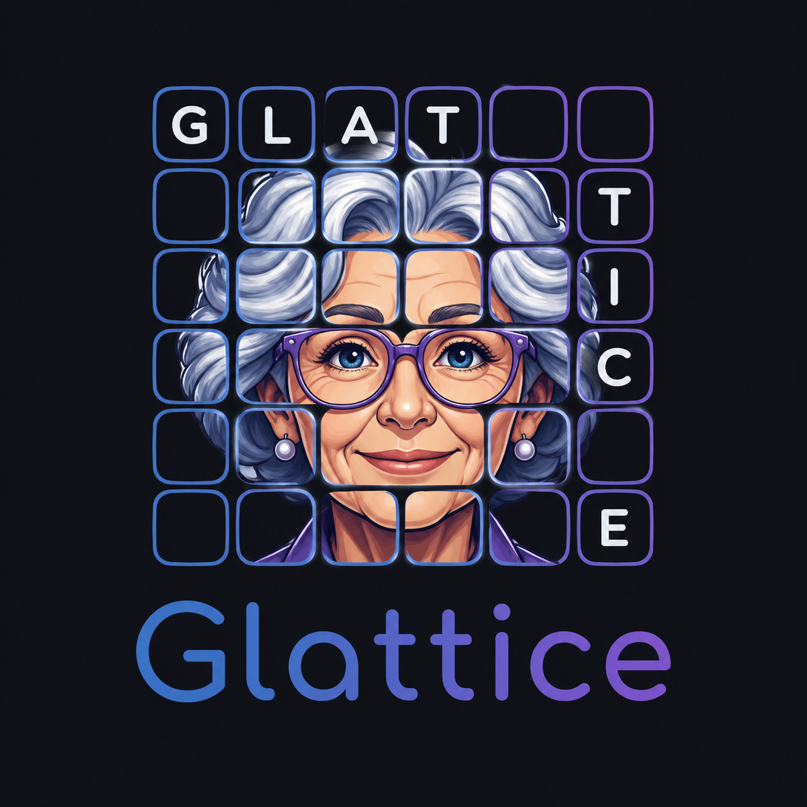

# Glattice

<p align="center">
  
</p>

A lightweight desktop screen recorder built for bug reports and tutorials. Record your screen, annotate individual frames, then export as an animated GIF, MP4/WebM, or a sprite sheet you can paste directly into a GitHub issue.

Built with [Tauri v2](https://tauri.app), React 19, and Rust.

---

## Features

### Recording
- **Full-screen or region capture** — drag to select any area, or snap to a detected window
- **Configurable FPS** — presets (2 / 5 / 10 / 15 / 30) plus a custom input
- **Click indicators** — animated ripple rings baked into the output (left = amber, right = red, middle = purple)
- **Key press display** — recent keystrokes shown as on-screen chips (e.g. `Ctrl+S`)
- **Cursor overlay** — cursor re-drawn on top of all edits so it stays sharp; can be off, baked, or overlay
- **Audio recording** — optional microphone capture, muxed into MP4 / WebM exports
- **Countdown timer** — 0–10 s delay before capture starts

### Editing
- **Per-frame annotation tools** — arrows, rectangles, ellipses, freehand lines, and text labels
- **Blur** — drag a region to apply Gaussian blur (radius 2–40 px) for privacy
- **Simplify** — AI-style text redaction: detects text blocks and replaces them with solid rounded shapes; tunable block size, threshold, merge, and roundness
- **Trim** — set in/out points with `I` / `O` keys (or drag the scrubber handles); trimmed frames are excluded from all exports
- **Frame exclude** — hide individual frames from playback and export without deleting them
- **Undo** — `Ctrl+Z` removes the last edit on the current frame
- **Copy edits to all frames** — apply the current frame's annotations to every frame at once

### Playback
- **Player** with scrubber, loop / boomerang / play-once modes
- **Speed control** — 0.25× to 4× playback multiplier
- **Grid view** — thumbnail overview of all frames; exclude/restore with one click
- **Zoom editor** — full-size per-frame editing with resize handles on every annotation

### Export
| Format | Notes |
|--------|-------|
| **Animated GIF** | Standard encoder; high-quality option via gifski (see below) |
| **MP4** | H.264 + AAC, WebCodecs-based encoding in-browser |
| **WebM** | VP9 + Opus |
| **Sprite sheet** | PNG / JPEG / WebP; configurable columns, padding, borders, frame number / timestamp annotations |

- **Drag-out** — drag the GIF or sprite sheet preview directly into Slack, Discord, a file manager, or a browser upload field
- **Save dialog** — choose destination and format, or use a configured default folder

### UI
- **Compact mode** — small always-on-top window; toggle from Settings
- **Light / dark / system theme**
- **Recent history** — last 20 recordings / imports with thumbnails

---

## Building

### Prerequisites

- [Rust](https://rustup.rs) (stable)
- [Node.js](https://nodejs.org) ≥ 20 + [pnpm](https://pnpm.io)
- Tauri CLI v2: `cargo install tauri-cli --version "^2"`

### Dev

```sh
pnpm install
pnpm tauri dev
```

### Release

```sh
pnpm tauri build
```

### High-quality GIF (gifski)

gifski produces better color palettes using pngquant's cross-frame optimization, but is **AGPL-3.0**. It is opt-in so default builds stay MIT-clean:

```sh
pnpm tauri build --features glattice/gifski
# or from src-tauri/:
cargo build --release --features gifski
```

The UI surfaces "High quality" GIF encoding automatically when the feature is compiled in.

---

## Tech stack

| Layer | Technology |
|-------|-----------|
| Shell | Tauri v2 |
| Frontend | React 19 + TypeScript + Vite |
| Screen capture | [`xcap`](https://crates.io/crates/xcap) |
| GIF encode | [`gif`](https://crates.io/crates/gif) + optional [`gifski`](https://crates.io/crates/gifski) |
| Video encode | [mediabunny](https://github.com/nicolo-ribaudo/mediabunny) (WebCodecs) |
| Audio capture | [`cpal`](https://crates.io/crates/cpal) + [`hound`](https://crates.io/crates/hound) |
| Sprite sheet | Custom Rust compositor (`image` crate) |

---

## License

MIT — except when built `--features gifski`, which links AGPL-3.0 code.
